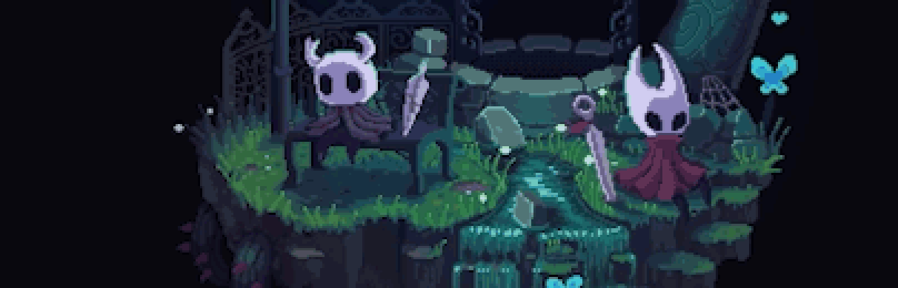

# Pixel Hollow Knight [Animated] — Vivaldi

Firefox teması **Pixel Hollow Knight [Animated] v7.0**'ın Vivaldi'ye taşınmış hâli.
Animasyonlu piksel sanatı, Firefox'taki gibi pencerenin sağ üst köşesinde orijinal boyutunda durur;
sekme, adres ve yer imi çubukları şeffaftır. Başlangıç sayfasındaki Pano widget'ları ekranın en altında durur.

A Vivaldi port of the Firefox theme **Pixel Hollow Knight [Animated] v7.0**.
The animated pixel art sits in the top-right corner at its original size, just like in Firefox,
behind transparent tab, address and bookmark bars. Start Page dashboard widgets sit at the bottom of the screen.

---

## Türkçe

### İçerik

| Dosya | Ne işe yarar |
| --- | --- |
| `1-tema/pixel-hollow-knight-vivaldi.zip` | Vivaldi teması (renkler + arka plan görseli) |
| `2-css-mod/hollow-knight.css` | Animasyonlu görsel, şeffaf çubuklar ve alta hizalı Pano widget'ları |
| `3-js-mod/` | İsteğe bağlı: Chrome/Edge gibi sekme açılış ve kapanış animasyonu |

İkisi birlikte kullanılmalıdır. Tema tek başına yalnızca renkleri ve arka plan görselini uygular.

### Kurulum

1. **Temayı yükleyin:** Ayarlar → Temalar → **İçe Aktar** → `1-tema/pixel-hollow-knight-vivaldi.zip`
2. **CSS modlarını açın:** Adres çubuğuna `vivaldi://experiments` yazın,
   **Allow for using CSS modifications** seçeneğini işaretleyin ve Vivaldi'yi yeniden başlatın.
3. **Modu ekleyin:** Ayarlar → Görünüm → **Özel Arayüz Değişiklikleri** → `2-css-mod` klasörünü seçin.
   Vivaldi'yi tekrar yeniden başlatın.

> Vivaldi seçilen klasördeki bütün `.css` dosyalarını yükler. `2-css-mod` klasörüne başka dosya koymayın.

4. **(İsteğe bağlı) Sekme açılış/kapanış animasyonu:** Vivaldi'yi kapatın, `3-js-mod` klasöründe PowerShell açıp
   `powershell -ExecutionPolicy Bypass -File .\install-js-mod.ps1` komutunu çalıştırın. Bu adım Vivaldi güncellendikten sonra tekrarlanmalıdır.
   Kaldırmak için: `powershell -ExecutionPolicy Bypass -File .\install-js-mod.ps1 -Uninstall`
### Kaldırma

Ayarlar → Görünüm → Özel Arayüz Değişiklikleri alanını temizleyin, ardından temayı Temalar sayfasından silin.
---

## English

### Contents

| File | Purpose |
| --- | --- |
| `1-tema/pixel-hollow-knight-vivaldi.zip` | Vivaldi theme (colours + background image) |
| `2-css-mod/hollow-knight.css` | Animated artwork, transparent bars and bottom-aligned dashboard widgets |
| `3-js-mod/` | Optional: Chrome/Edge-style tab open and close animation |

Use both together. The theme alone only applies the colours and the background image.

### Installation

1. **Install the theme:** Settings → Themes → **Import** → `1-tema/pixel-hollow-knight-vivaldi.zip`
2. **Enable CSS mods:** open `vivaldi://experiments`, tick
   **Allow for using CSS modifications** and restart Vivaldi.
3. **Add the mod:** Settings → Appearance → **Custom UI Modifications** → choose the `2-css-mod` folder.
   Restart Vivaldi again.

> Vivaldi loads every `.css` file in the chosen folder, so keep only this mod in `2-css-mod`.

4. **(Optional) Tab open/close animation:** close Vivaldi, open PowerShell in the `3-js-mod` folder and run
   `powershell -ExecutionPolicy Bypass -File .\install-js-mod.ps1`. Repeat this after every Vivaldi update.
   To remove it: `powershell -ExecutionPolicy Bypass -File .\install-js-mod.ps1 -Uninstall`
### Uninstall

Clear Settings → Appearance → Custom UI Modifications, then delete the theme from the Themes page.
---

## Krediler / Credits

- Orijinal Firefox teması / Original Firefox theme: *Pixel Hollow Knight [Animated]* (Firefox Add-ons)
- Hollow Knight © Team Cherry. Bu, resmî olmayan bir hayran çalışmasıdır. / This is an unofficial fan work.
